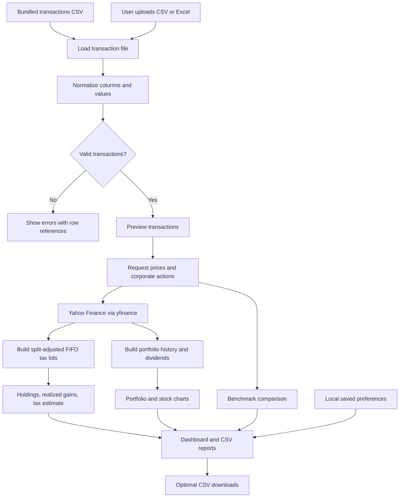
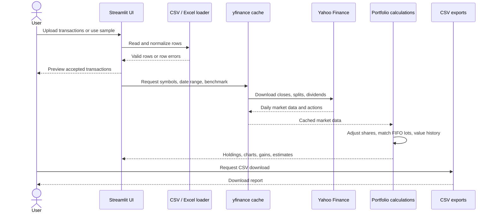
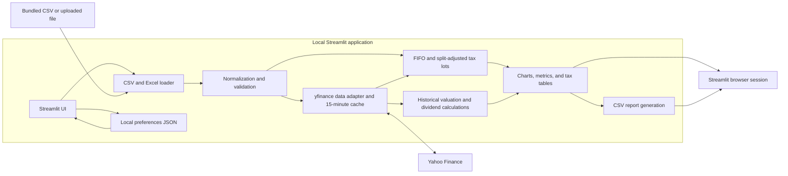

# Stock Portfolio App — Design Document

## 1. Purpose

The Stock Portfolio App is a local Streamlit dashboard for reviewing stock transactions, current holdings, historical portfolio value, and estimated capital gains. Users provide transactions as CSV or Excel files; the app retrieves daily market prices and corporate actions through yfinance.

The app is intended for personal monitoring and planning. It is not a brokerage system, a source of guaranteed real-time prices, or tax preparation software.

## 2. Product goals

- Make it simple to load, review, and correct transaction data.
- Show portfolio history and individual-stock history with understandable charts.
- Show holdings, allocation, cost basis, gains and losses, and dividends received.
- Identify realized and open gains as short-term or long-term under the configured U.S. federal estimate.
- Make assumptions visible and allow the user to adjust the estimate rates.
- Allow the user to export the key tables and save dashboard preferences locally.

## 3. Intended users and use cases

The primary user is an individual investor tracking a portfolio from a transaction export. Typical use cases:

1. Upload a broker transaction file and confirm the normalized transactions.
2. Review current positions, market value, cost basis, and allocation.
3. Inspect portfolio or individual-stock history over a chosen period.
4. Compare an indexed portfolio history with a selected market benchmark.
5. Review realized gains by tax year and holding period, and estimate tax under editable rates.
6. Export holdings, transactions, or realized gain summaries as CSV.

## 4. Application structure

The application is a single-page Streamlit app (`app.py`) with the following areas:

| Area | Purpose |
|---|---|
| Sidebar | Upload transactions, choose a benchmark, set assumed short- and long-term rates, and save preferences. |
| Upload review | Validate required fields, report common errors with spreadsheet row numbers, and preview accepted transactions. |
| Portfolio metrics | Show current market value, open cost basis, unrealized gain or loss, and dividends received. |
| Historical view | Chart historical portfolio value including dividends retained as cash, select a date range, and compare indexed history with SPY, QQQ, or DIA. |
| Allocation and stock detail | Show a holding allocation donut and selected ticker price history with transaction markers. |
| Tax view | Show realized gains by tax year and holding period, open tax lots, and an estimated tax impact. |
| Holdings and exports | Show current positions and download CSV reports. |

## 5. Transaction input

CSV and Excel inputs use the first worksheet and require these case-insensitive columns:

| Column | Meaning | Example |
|---|---|---|
| `ticker` | Yahoo Finance symbol | `AAPL` |
| `date` | Trade date | `2025-01-31` |
| `transaction_type` | Trade direction | `BUY` or `SELL` |
| `quantity` | Number of shares traded | `10` |
| `price` | Price per share in the transaction currency | `185.07` |

Input validation normalizes tickers and transaction types, parses dates and numbers, rejects blank or invalid values, and requires positive quantity and price. Sell activity is also checked against available shares. Split adjustments are applied to lots before validating post-split sales.

The app can use a local `transactions.csv` starter file, but transaction data is not included in the repository. When that file is absent, users must upload a CSV or Excel workbook. Uploading a file applies it to that app session and does not overwrite the local starter file.

## 6. Data flow and calculations

### Data flow



The upload branch and bundled-data branch converge at the same normalization and validation step. Invalid input stops before market data is requested. Valid transactions drive both the historical valuation and tax-lot calculations.

### Calculation sequence



1. Read the bundled CSV or uploaded CSV/XLSX file.
2. Normalize and validate transaction fields, then show a transaction preview.
3. Request daily closing prices, stock split events, and dividend events for held symbols and the selected benchmark through yfinance.
4. Adjust share quantities and per-share basis for splits.
5. Match sales to purchases using FIFO, since the input does not identify specific tax lots.
6. Calculate current holdings, market value, cost basis, unrealized gain or loss, and holding periods.
7. Build historical value from daily closing prices, adjusted historical share counts, and accumulated dividends. The chart assumes dividends remain in cash.
8. Build the benchmark comparison by rebasing the portfolio value and benchmark price series to 100 over the selected period.
9. Calculate the configurable tax estimate from realized gains grouped by tax year and term; estimate hypothetical tax on open gains as if sold at current prices.
10. Offer CSV downloads and optionally persist dashboard preferences in a local JSON file.

Market results are cached for 15 minutes. The benchmark comparison is an indexed view rather than a cash-flow-adjusted return calculation.

## 7. Tax estimate behavior

The tax panel is designed as a directional estimate. It uses FIFO lot matching and editable short-term and long-term rate assumptions. In the U.S. general rule, assets held one year or less are short-term, while assets held more than one year are long-term. See [IRS Topic 409](https://www.irs.gov/taxtopics/tc409).

The current estimate separately nets gains and losses within each holding-period category and tax year, then applies the selected rate to positive net gains. Open-lot tax is a hypothetical estimate assuming positions are sold at displayed prices. The app does not model all tax return interactions or exceptions.

The estimate excludes, among other things, loss netting between short- and long-term categories, loss carryovers, state taxes, the net investment income tax, wash-sale adjustments, fees, and user-specific tax bracket calculations. FIFO may differ from the lots actually selected at a broker. Users should reconcile transactions and lots with brokerage statements and consult a tax professional for filing.

## 8. Preferences and exported data

### Technical architecture



The app is a single Python process. Streamlit handles page state and rendering; pandas handles tabular data; yfinance retrieves market data; Plotly renders the allocation donut; and a local JSON file stores preferences. The app does not use a database or send transactions to Yahoo Finance.

Preferences (benchmark, chart period, and tax rates) are saved to `preferences.json` in the app directory when the user selects **Save dashboard preferences**. That file is excluded from Git by the app’s `.gitignore`.

CSV exports include:

- Current holdings and calculated portfolio columns.
- The normalized transaction history used by the app.
- Realized gain/loss summaries grouped by tax year and holding period.

## 9. Errors and recovery

- Missing required columns stop processing and list the missing headers.
- Invalid values identify spreadsheet row numbers where possible.
- Invalid transaction types and nonpositive quantity or price are rejected.
- A sale that exceeds available shares produces a ticker and sale-date error.
- Missing Yahoo Finance price history identifies the affected ticker symbols.
- Price results are cached; users can refresh the Streamlit app to request updated data after the cache expires or is cleared.

## 10. Current limitations

- The benchmark comparison does not adjust for deposits, withdrawals, or timing and size of added investments.
- Sale proceeds are not tracked as a cash balance, so the portfolio value chart represents invested stock positions plus received dividends, not a full brokerage account balance.
- Dividends are recorded as cash and are not reinvested in the historical series.
- Corporate actions beyond stock splits and cash dividends are not modeled.
- Yahoo Finance data can be delayed, incomplete, unavailable for some symbols, or revised.
- The app assumes one transaction currency and currently formats amounts in dollars.
- Tax assumptions and calculations are not filing-grade and do not cover all U.S. federal or state tax rules.
- Preferences are local to the app directory and computer; they are not synced across devices.

## 11. Roadmap

### Near term

- Add an optional transaction `fee` column and include fees in basis and realized proceeds.
- Allow configurable base currency and foreign-exchange conversion.
- Add downloadable open tax lots and a richer realized-sale detail export.
- Add cash deposits and withdrawals so the app can calculate time-weighted or money-weighted returns.
- Improve upload validation with a downloadable rejected-row report and an option to map alternate broker column names.

### Later

- Allow specific-lot identification in addition to FIFO.
- Add dividend reinvestment settings and support for additional corporate actions.
- Add user-selectable benchmarks and benchmark-specific date ranges.
- Add a multi-account view and import profiles for common broker exports.
- Add persistent storage for transaction history and preferences beyond local files.

## 12. Local run instructions

From the `StockPortfolio` directory:

```powershell
python -m venv .venv
.venv\Scripts\Activate.ps1
pip install -r requirements.txt
streamlit run app.py
```
